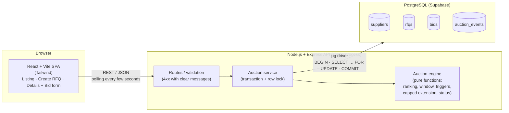
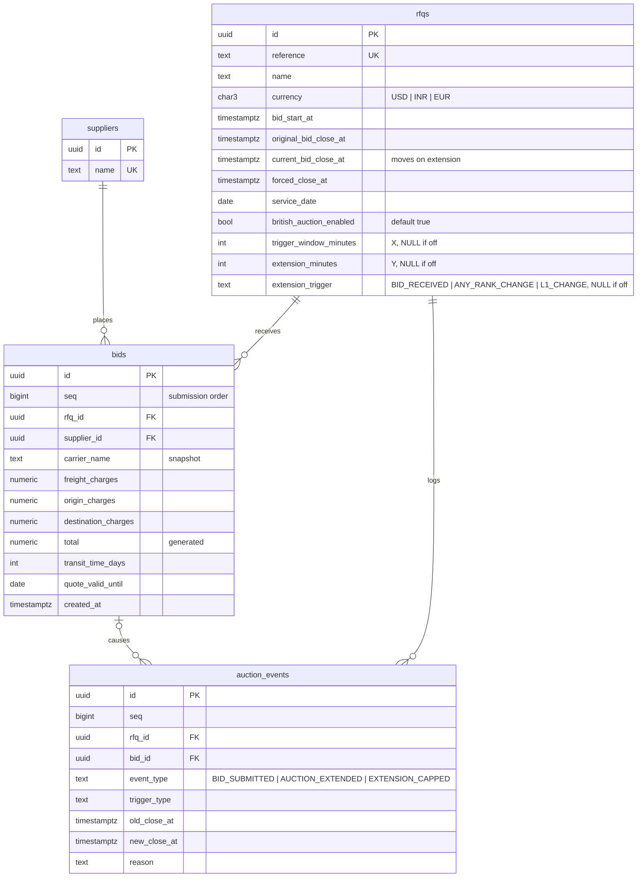
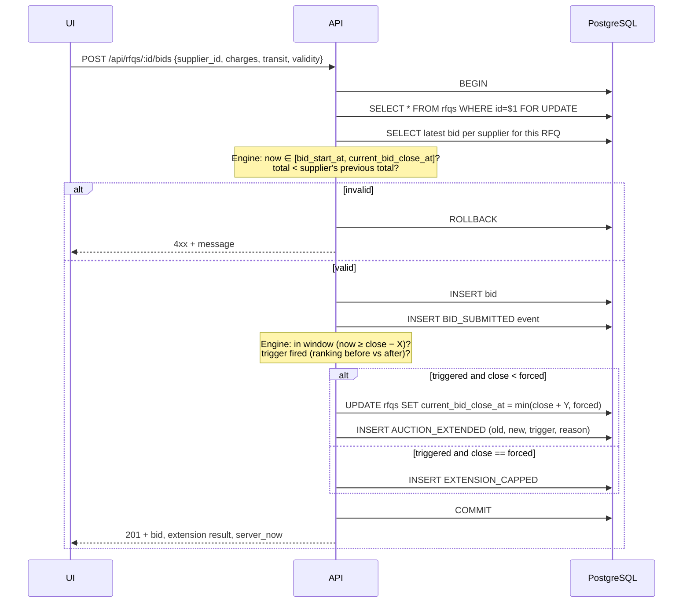

# RFQ British Auction: High-Level Design

## 1. Scope

A simplified RFQ (Request for Quotation) system in which suppliers compete in a
**British Auction**. They bid openly, keep lowering their prices, and the auction
extends automatically when there is activity near the close. It can never run past
a hard **forced close time**.

The deliverables covered here are the HLD with an architecture diagram (this file)
and the schema design ([schema.sql](schema.sql)). The backend and frontend code
live in `/backend` and `/frontend`.

## 2. Architecture

| Component | Responsibility |
|---|---|
| **Frontend (React)** | Three screens: the auction listing, the RFQ creation form, and the auction details page with the bid form. It polls the API and drives countdowns from the `server_now` value returned by the server, not the browser clock. It shows times in the browser's local timezone. |
| **Routes** | Parse and validate input, map domain errors to 4xx responses, and attach `server_now` to every response. |
| **Auction service** | Runs the bid flow inside one database transaction with a row lock on the RFQ. Persists bids, the RFQ close time, and events. |
| **Auction engine** | Pure, side-effect-free functions that hold all business rules. It is unit-tested with Vitest and needs no database. |
| **PostgreSQL** | System of record. CHECK constraints also enforce the time ordering and the forced-close cap, as a second line of defence. |

The runtime API uses Supabase's pooled connection (`DATABASE_URL`). An explicit
`BEGIN … COMMIT` on one checked-out client is safe in transaction-pooling mode.
Migrations, seeding, and integration tests use the direct connection (`DIRECT_URL`
and `DATABASE_URL_TEST`).

## 3. Data model

Full DDL: [schema.sql](schema.sql).

Key design decisions:

- **Auction status is never stored.** It is derived from timestamps on every read
  (section 5), so no background job is needed to flip statuses.
- **The British Auction option is a column (`british_auction_enabled`, default on).**
  When it is off, X, Y and the trigger are NULL. The `rfq_auction_config` CHECK
  constraint enforces that pairing, so a row can never be half-configured.
- **`original_bid_close_at` and `current_bid_close_at` are separate columns.** This
  keeps the configured close time visible and lets the UI show how far the auction
  has been extended.
- **`bids.total` is a generated column** with type `numeric(12,2)`. The totals used
  for ranking and display can never drift from the individual charges.
- **`bids.seq` is an identity column.** It gives a strict submission order for the
  "earlier submission wins" tie-break, even when two rows share a `created_at` value.
- **`bids.carrier_name` stores the supplier's name at bid time.** A later rename of
  the supplier does not rewrite historical quotes.
- **`auction_events` is append-only.** It is the source of the activity log on the
  details page.

## 4. Bid submission flow

Concurrency: `SELECT … FOR UPDATE` serialises all bids on the same RFQ. When a
second bid gets the lock, it re-reads the already-extended `current_bid_close_at`
and the first bid's ranking. Two simultaneous in-window bids therefore cannot both
extend from the same base close time, and neither can push past `forced_close_at`.
Bids on different RFQs do not block each other.

## 5. Auction engine rules

**Bid validity**
- Server time must fall within `[bid_start_at, current_bid_close_at]`, with both
  ends inclusive. Bids after `current_bid_close_at` are rejected even if
  `forced_close_at` has not passed.
- `total = freight + origin + destination`. The total must be strictly lower than
  the supplier's own previous total on this RFQ, if they have one.

**Ranking**
- Only each supplier's latest bid counts.
- Bids are sorted by total, ascending. On a tie, the earlier submission (`seq`)
  ranks higher.
- Rank 1 is **L1**, then L2, L3, and so on.

**British Auction option**
- Every RFQ has a British Auction option, on by default.
- When it is **off** (a "standard RFQ"), the bid close time is fixed: no bid ever
  extends it, and no extension events are written. The bid acceptance and ranking
  rules are unchanged.
- The rules below apply only when the option is **on**.

**Trigger window**
- A bid is in the trigger window if `bid_time ≥ current_bid_close_at − X minutes`.
- If the bid is in the window, the configured trigger decides whether to extend:

| Trigger | Extends when |
|---|---|
| `BID_RECEIVED` | Always, for any accepted bid in the window. |
| `ANY_RANK_CHANGE` | The ordered supplier list differs before and after the bid. A new supplier entering the ranking counts as a change. A supplier who lowers their price but keeps the same position does **not**. |
| `L1_CHANGE` | The supplier at rank 1 is different after the bid. The first-ever bid on an RFQ counts as an L1 change. |

**Extension (rolling, capped)**
- `new_close = min(current_bid_close_at + Y, forced_close_at)`.
- If `current_bid_close_at` already equals `forced_close_at`, the auction cannot
  extend. An `EXTENSION_CAPPED` event is logged instead.

**Derived status** (`now` is server time)

| Status | Condition |
|---|---|
| `SCHEDULED` | `now < bid_start_at` |
| `ACTIVE` | `bid_start_at ≤ now ≤ current_bid_close_at` |
| `CLOSED` | `now > current_bid_close_at` and `current_bid_close_at < forced_close_at` |
| `FORCE_CLOSED` | `now > current_bid_close_at` and `current_bid_close_at = forced_close_at` (extensions hit the cap) |

`SCHEDULED` extends the PDF's three statuses on purpose. It lets a buyer see an
RFQ that has been created but has not started yet.

## 6. API surface

Every successful response includes `server_now` (ISO 8601, UTC).

| Method | Path | Purpose |
|---|---|---|
| `GET` | `/api/suppliers` | Suppliers for the "Bid as" dropdown |
| `GET` | `/api/rfqs` | Listing: name/reference, current lowest bid, current close, forced close, status |
| `POST` | `/api/rfqs` | Create an RFQ with its auction configuration (validated) |
| `GET` | `/api/rfqs/:id` | Details: RFQ, X/Y and trigger configuration, ranked bids with full quote details, activity log |
| `POST` | `/api/rfqs/:id/bids` | Submit a quote (one transaction, as in section 4) |

Error responses use the shape `{ "error": "<human-readable message>" }`, with:
- 400 for invalid input
- 404 for an unknown RFQ or supplier
- 409 when the auction is not open or the bid is not lower than the supplier's
  previous bid

## 7. Time handling

- All timestamps are stored as `timestamptz` and compared in UTC on the server.
  "Now" is always the database clock (`clock_timestamp()`), read after the RFQ row
  lock is taken. Bid validation, `created_at`, status, and `server_now` therefore
  share one clock, and a bid that waited for the lock is judged at its real time.
- The frontend converts to the browser's local time only for display. The create
  form converts local `datetime-local` input to UTC ISO strings before sending.
- Countdown timers use the offset between `server_now` and the browser clock, so
  client clock skew cannot show a wrong timer. When a poll shows that
  `current_bid_close_at` has moved, the countdown is briefly highlighted so the
  extension is visible.

## 8. Simple choices now, and how they would scale

The current build uses one process and one database, with no queues and no Redis.
Each simple choice has a scalable replacement:

| Concern | Now | Scalable version |
|---|---|---|
| Live updates | The client polls every few seconds | Push over WebSockets or SSE. A Postgres `LISTEN/NOTIFY` channel or Redis pub/sub fans out to API instances. |
| Bid serialisation | A row lock (`SELECT … FOR UPDATE`) per RFQ | Still sufficient at high volume, because each lock covers a single RFQ. For extreme hot spots, add a per-RFQ single-writer queue (partitioned by RFQ ID) in front of the database. |
| Status transitions | Derived on read; no jobs | A scheduler (cron, pg_cron, or a delayed queue) that emits "auction closed" events for notifications or awarding |
| API scaling | One Node process | Stateless, so it can scale horizontally behind a load balancer. Correctness relies only on the database lock. |
| Database connections | Supabase pooler | Same, plus read replicas for the listing and details reads |
| Read load on listing | Computed per request | A cached or materialised `rfq_summary` (lowest bid, status) refreshed on bid commit |
| Auth | None; one shared UI with a "Bid as" dropdown | Buyer and supplier accounts. Supplier identity comes from the session, and bids are authorised per RFQ invitation. |

## 9. Assumptions beyond the PDF

1. **No login.** There is one UI with no buyer/supplier role split. Suppliers are
   seeded and chosen from a "Bid as" dropdown, which sends `supplier_id`. The quote
   form's carrier name is filled in automatically and read-only.
2. **Currency per RFQ.** The RFQ has a `currency` field (USD / INR / EUR, default
   USD), and all amounts are formatted with it.
3. **`SCHEDULED` status** is added for RFQs that have not started yet.
4. **One bid per supplier counts.** A supplier may re-bid, but each new bid must be
   strictly lower than their own previous total.
5. **Transit time is in days, and quote validity is a "valid until" date.** The PDF
   names these fields but does not give their units.
6. **British Auction is an option on the create form** (a checkbox, on by default).
   With it off, X, Y and the trigger are hidden and not stored. The forced close
   time is still required, because the PDF lists it as a key field of the form.
